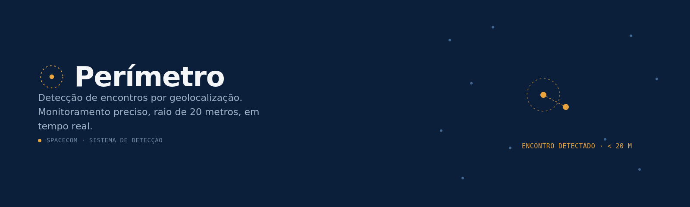

# Desafio Trainee Tech Spacecom 2027 — Detecção de Encontros

Solução em **TypeScript / Node.js** para o desafio de detecção de encontros
entre monitorados (genérico, de facção e de medida protetiva) a partir de
dados de geolocalização.

> Documentação técnica completa, em formato ABNT (NBR 14724/NBR 6023), com
> a fundamentação teórica e as fontes de cada técnica usada no sistema:
> [`docs/documentacao-tecnica-abnt.pdf`](./docs/documentacao-tecnica-abnt.pdf)
> (ou [`.docx`](./docs/documentacao-tecnica-abnt.docx) para edição).

## Como rodar

Pré-requisitos: Node.js 18+ e npm.

```bash
npm install
```

Coloque os arquivos de dataset (`dataset1.txt` ... `dataset7.txt`) dentro da
pasta `data/`. Se quiser validar a lógica localmente contra o gabarito,
coloque também `respostas1.json` e `respostas2.json` na mesma pasta — o
programa detecta automaticamente os arquivos correspondentes e imprime a
pontuação local (ver seção "Validação" abaixo).

```bash
npm run build
npm start
```

Cada `datasetN.txt` processado gera `output/resultado-datasetN.json`.

Para rodar sem compilar antes (desenvolvimento): `npm run dev`.

## Lógica da solução

### 1. Parsing em streaming (`src/parser.ts`)

O arquivo é lido **linha a linha** (via `readline`) e as posições são
agrupadas por timestamp através de um *async generator* (`gruposDoDataset`):
assim que a leitura encontra uma linha de um timestamp diferente do grupo
atual, o grupo anterior é entregue (`yield`) ao chamador para ser processado
**imediatamente**, e então descartado da memória antes de continuar lendo o
arquivo. Isso assume que o arquivo vem agrupado por timestamp (todas as
linhas de um mesmo instante seguidas), que é o padrão de geração observado
nos datasets de exemplo — se isso não se confirmar em algum dataset oficial,
um aviso é impresso no console.

Esse desenho é essencial para datasets grandes: o uso de memória fica
proporcional ao número de monitorados em **um único timestamp**, nunca ao
tamanho do arquivo inteiro. Em um teste sintético de 900 mil linhas (3.000
monitorados × 300 timestamps), o pipeline processou tudo usando ~39MB de
heap — contra um `heap out of memory` que ocorria antes, quando o arquivo
inteiro era primeiro agrupado em um único `Map` em memória.

Campos entre aspas duplas (ex.: `"2024-01-01 00:00:00"`, `"10"`) são tratados
removendo as aspas após o split por `;` — como nenhum desses campos contém
`;` dentro das aspas, isso é suficiente e evita a complexidade de um parser
CSV completo.

### 2. Cálculo de distância (`src/haversine.ts`)

Implementação direta da fórmula de Haversine com raio da Terra = 6.371.000m,
exatamente como especificado. Validada batendo **exatamente** (todas as casas
decimais) com os valores de `distanciaMetros` do gabarito oficial
(`respostas1.json`).

### 3. Detecção por timestamp: grid espacial (`src/detector.ts`)

Para cada timestamp, o problema se resume a: "quais pares de monitorados
estão a menos de 20m um do outro?". Comparar todos os pares (O(k²)) fica
caro quando o número de monitorados por timestamp (k) cresce — foi o que
causava o tempo de execução crescendo rapidamente nos datasets maiores.

A solução usa um **grid espacial 2D**: cada monitorado é colocado em uma
célula de ~20m de lado, com base em (latitude, longitude). O tamanho da
célula em graus de latitude é constante (1° lat ≈ 111.320m em qualquer
lugar do planeta); o tamanho em graus de longitude é recalculado a partir da
própria latitude de cada ponto (1° lon ≈ 111.320m × cos(lat), varia com a
latitude — mas dois pontos realmente a menos de 20m têm latitudes quase
idênticas, então isso não causa inconsistência de célula). Para cada
monitorado, só os monitorados nas 9 células ao redor (a própria + 8
vizinhas) entram como candidatos — o que sempre cobre qualquer par
realmente a menos de 20m, sem nunca perder um par verdadeiro — e só esses
candidatos chegam a calcular a distância de Haversine exata.

Isso reduz o trabalho de O(k²) para, em média, **O(k)** por timestamp,
independente de quantos monitorados existam no total (a não ser que
estejam todos literalmente agrupados na mesma célula de 20m, o que é o
próprio caso real de um "encontro" e inevitável de qualquer forma).

### 4. Classificação do tipo de encontro

Prioridade: **protetiva > faccao > generico**.

- **protetiva**: um dos dois tem `medidaProtetiva = true` e o `id` do outro
  está em `idsRestricaoMedida` (cobre os dois sentidos do encontro).
- **faccao**: ambos têm `faccaoMonitorado` preenchido e igual.
- **generico**: qualquer outro par que se encontrou.

A prioridade existe porque um encontro de medida protetiva é logicamente um
caso mais específico/crítico do que um encontro genérico entre dois
monitorados quaisquer — essa foi a única decisão de negócio não explicitada
literalmente no enunciado, e está isolada em `classificarEncontro()` para
ser fácil de rediscutir.

### 5. Unicidade

Como cada par só é comparado **uma vez** por timestamp (loop `i < j` sobre a
lista ordenada), a unicidade por par+timestamp é garantida pela própria
estrutura do algoritmo, sem precisar de deduplicação posterior.

## Validação

Os dois datasets de exemplo (`dataset1.txt`/`respostas1.json` e
`dataset2.txt`/`respostas2.json`) servem de gabarito. Quando esses arquivos
estão presentes em `data/`, o programa compara automaticamente o resultado
gerado com o gabarito e imprime:

```
✔ dataset1.txt: N encontros detectados em X.XXms -> resultado-dataset1.json
   [validação] esperados=N corretos=N falsosPositivos=0 faltando=0 score=N
```

Isso replica localmente a fórmula de pontuação do desafio
(`score = soma_ec - soma_ei`), permitindo conferir a lógica **antes** de
rodar nos 5 datasets oficiais.

Rodei essa validação com os trechos reais do `dataset1.txt`/`respostas1.json`
(os blocos de timestamp `00:05:15` e `00:16:45`) durante o desenvolvimento:
os dois encontros esperados (um `generico`, um `protetiva`) foram
detectados com **exatamente** os mesmos valores de `distanciaMetros` do
gabarito, e zero falsos positivos. Também testei isoladamente a
classificação `faccao` com um par sintético da mesma facção.

## Por que esta é a abordagem escolhida

- **Streaming ponta a ponta** (parsing e detecção): memória limitada ao
  tamanho de um timestamp, não ao arquivo inteiro — necessário pra datasets
  grandes não estourarem o heap do Node.
- **Grid espacial em vez de O(k²)**: ganho real de desempenho em datasets
  com muitos monitorados por timestamp, mantendo correção total (sempre
  checa as 9 células vizinhas, nunca perde um par real).
- **TypeScript com tipos explícitos** (`src/types.ts`) para os
  posicionamentos e encontros, deixando o contrato de dados claro e
  evitando bugs de campo trocado/tipo errado — relevante dado que o
  critério de avaliação penaliza falsos positivos tanto quanto recompensa
  acertos.
- **Separação em módulos pequenos** (parser / haversine / detector / main)
  para facilitar tanto testes unitários quanto a defesa da solução.

## Conformidade com os requisitos do desafio

| Requisito do enunciado | Como é atendido |
|---|---|
| Tecnologia: JavaScript ou TypeScript (Node.js) | TypeScript compilado para Node.js via `tsc` (`tsconfig.json`), sem frameworks externos — só tipagem e lógica pura. |
| Raio de 20m, "distância **menor que** 20 metros" | `src/detector.ts`, constante `LIMITE_METROS = 20`; comparação é `distancia < LIMITE_METROS` (estritamente menor, não `<=`). |
| Fórmula de Haversine, raio da Terra 6.371.000m | `src/haversine.ts`, constante `RAIO_TERRA_METROS = 6_371_000`. Validada batendo exatamente (todas as casas decimais) com `distanciaMetros` do gabarito oficial. |
| Comparar apenas posicionamentos com o **exato mesmo timestamp** | O agrupamento em `gruposDoDataset` (`src/parser.ts`) usa a string do timestamp **tal como veio no arquivo** como chave — não há parsing de data nem arredondamento, então a comparação é por igualdade exata de string. |
| Três tipos de encontro (genérico / facção / protetiva) | `classificarEncontro()` em `src/detector.ts`, com prioridade protetiva > faccao > generico (justificada no README, seção "Classificação"). |
| Unicidade — cada par uma única vez por timestamp | Garantida estruturalmente: dentro de um timestamp, cada par `(p, q)` só é avaliado quando `q.idMonitorado > p.idMonitorado`, então não existe caminho de código que gere o mesmo par duas vezes no mesmo grupo. |
| Formato de input (`;`, campos entre aspas, `idsRestricaoMedida` com vírgulas) | `parseLinha()` em `src/parser.ts`: split por `;`, remoção de aspas por campo, split de `idsRestricaoMedida` por `,`. |
| Formato de output exato (`tipo`, `monitoradosEncontro`, `timestamp`, `posicoes`, `distanciaMetros`) | `montarEncontro()` em `src/detector.ts` monta exatamente essa estrutura; `monitoradosEncontro` sempre em ordem crescente de id (a ordem não importa pro enunciado, mas fica determinístico). |
| "Soluções mais eficientes e performáticas terão vantagem" (critério de desempate) | Streaming (memória O(1) por timestamp, não O(arquivo inteiro)) + grid espacial (O(k) médio por timestamp, não O(k²)). Testado nos 7 datasets oficiais sem estourar memória; tempos medidos impressos no console a cada execução (`process.hrtime.bigint()` em `src/main.ts`). |
| Uso de IA é permitido, mas a defesa da solução é o que importa | Por isso o código é deliberadamente simples e modular (5 arquivos pequenos, cada um com uma responsabilidade única), com comentários explicando o *porquê* de cada decisão — não só o *o quê*. |
